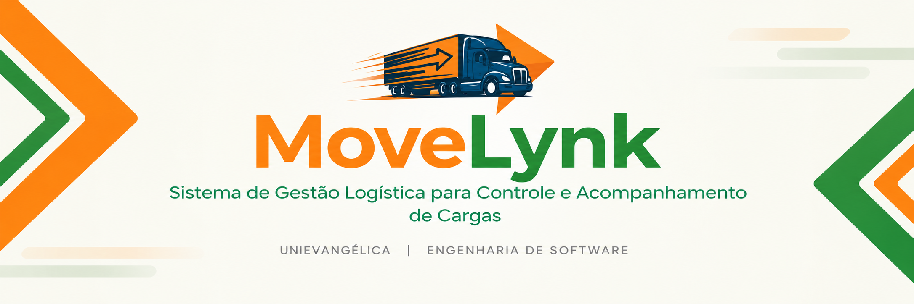

# MoveLynk | Sistema de Gestão Logística

  

  
  

## 📌 Sobre o repositório

Este repositório foi criado para centralizar o código-fonte do **MoveLynk**, organizar o desenvolvimento do sistema e facilitar o versionamento e a colaboração entre os integrantes da equipe.

Atualmente, o projeto está na **2ª fase do 2º período de Engenharia de Software**, com foco na pesquisa com usuários e na gestão do projeto. A implementação do código ainda não foi iniciada.

O repositório está sendo preparado antecipadamente para receber os códigos conforme o avanço das próximas etapas.

## 🎯 Objetivos

- 💻 Centralizar os códigos-fonte do sistema.
- 🔄 Manter o histórico de alterações com Git.
- 🤝 Facilitar a colaboração entre os integrantes.
- 📁 Organizar os arquivos e a evolução do desenvolvimento.

## 🚧 Status atual

O repositório está preparado para receber o código-fonte nas próximas etapas. As funcionalidades e a implementação técnica serão desenvolvidas de maneira progressiva.

---

  <strong>MoveLynk 🧡💚</strong>

